# Portafolio Personal - Actividad 4

**Autor:** Ruíz Jiménez Erandi Camila
> Este proyecto consiste en la creación y personalización de un portafolio web profesional multipágina basado en la plantilla oficial Start Bootstrap - Personal. El sitio web está desarrollado con tecnologías estándar (HTML5, CSS3, Bootstrap y JavaScript) y estructurado para reflejar la trayectoria académica, habilidades técnicas en bases de datos y desarrollo web, así como la exhibición de proyectos prácticos.

---

## Tecnologías y Plantilla Base

* Framework CSS: Se utiliza Bootstrap para garantizar un diseño completamente responsivo, limpio y moderno en cualquier dispositivo o tamaño de pantalla.

* Plantilla Base: Se adaptó la plantilla startbootstrap-personal (Personal Portfolio Bootstrap Template), personalizada con mi información académica, experiencia profesional y los proyectos desarrollados.


Página oficial de Start Bootstrap - Persona: https://startbootstrap.com/theme/personal

Repositorio oficial de la plantilla: https://github.com/startbootstrap/startbootstrap-personal

---

## Menús y Secciones del Portafolio

* index.html (Inicio / Home):

Descripción: Página principal de bienvenida que presenta de forma visual la identidad profesional, un saludo destacado, una fotografía de perfil y acceso rápido a los canales de comunicación o redes.

* resume.html (Perfil / Sobre mí):

Descripción: Sección dedicada a la trayectoria académica (cursando Ingeniería en Sistemas Computacionales en el Instituto Tecnológico de Oaxaca), la experiencia inicial en desarrollo de software y bases de datos, las habilidades profesionales y las tecnologías dominadas (Java, PostgreSQL, MySQL, JavaScript, Git/GitHub), incluyendo además un botón interactivo para la descarga del CV en formato PDF.

* projects.html (Proyectos):

Descripción: Incluye proyectos destacados como Baches-ITO (sistema inteligente de gestión vial con flujos en n8n, IA y backend en Java/PostgreSQL), MiVet (plataforma de control y expedientes veterinarios) y Artani (sistema de gestión administrativa para talleres artesanales), con enlaces directos a sus sitios web en vivo o repositorios.

* contact.html (Contacto):

Descripción: Sección interactiva que incluye un formulario de contacto conectado al servicio de Formspree para el envío seguro de correos. Cuenta con campos estructurados para nombre, correo electrónico, teléfono y mensaje, además de un sistema de alertas visuales que notifican el éxito del envío en tiempo real.

---

## Estructura del Proyecto

El proyecto está organizado de la siguiente manera:

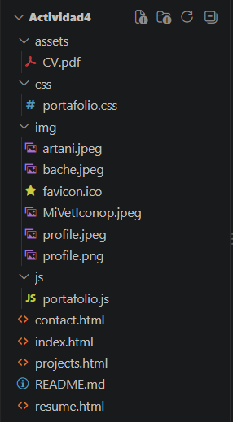

---

## Modificaciones Detalladas por Archivo

**3. Modificaciones Realizadas en el Archivo (index.html)**

1. Barra de Navegación Principal (navbar)
Se configuraron los enlaces internos del menú superior para permitir una navegación fluida entre las diferentes vistas del portafolio:

```html
<ul class="navbar-nav ms-auto mb-2 mb-lg-0 small fw-bolder">
    <li class="nav-item"><a class="nav-link" href="index.html">Home</a></li>
    <li class="nav-item"><a class="nav-link" href="resume.html">Perfil</a></li>
    <li class="nav-item"><a class="nav-link" href="projects.html">Proyectos</a></li>
    <li class="nav-item"><a class="nav-link" href="contact.html">Contacto</a></li>
</ul>
```

2. Encabezado Principal y Presentación (Masthead)
Se personalizó la insignia superior (badge), el título con efectos de gradiente y los botones de llamada a la acción (Call to Action) dirigidos hacia las secciones de perfil y proyectos:

```html
<div class="badge bg-gradient-primary-to-secondary text-white mb-4">
        <div class="text-uppercase">Diseño &middot; Desarrollo</div>
    </div>
    <div class="fs-3 fw-light text-muted">Programación Web y Bases de Datos</div>
    <h1 class="display-3 fw-bolder mb-5">
        <span class="text-gradient d-inline">Creando Soluciones Digitales</span>
    </h1>
```

3. Sección "Acerca de Mí" y Redes Sociales
Redacté mi biografía personal, estudiante de Ingeniería en Sistemas Computacionales y se integraron los hipervínculos con iconos vectoriales de Bootstrap hacia mis perfiles personales (Facebook, Instagram y GitHub):

```html
<div class="text-center my-5">
    <h2 class="display-5 fw-bolder"><span class="text-gradient d-inline">Acerca de Mi</span></h2>
    <p class="lead fw-light mb-4">Mi nombre es Erandi Camila y construyo Páginas Web y sistemas de Bases de Datos</p>
    <p class="text-muted">Estudiante de Ingeniería en Sistemas Computacionales, apasionada por la Programación, el manejo eficiente de datos y la creación de interfaces funcionales.</p>
    <div class="d-flex justify-content-center fs-2 gap-4">
        <!-- Enlace a Facebook -->
        <a class="text-gradient" href="https://www.facebook.com/cami.jimenez.523379" target="_blank">
            <i class="bi bi-facebook"></i>
        </a>
        <!-- Enlace a Instagram -->
        <a class="text-gradient" href="https://www.instagram.com/rjec.1989/" target="_blank">
            <i class="bi bi-instagram"></i>
        </a>
        <!-- Enlace a GitHub -->
        <a class="text-gradient" href="https://github.com/camicrts5-hash" target="_blank">
            <i class="bi bi-github"></i>
        </a>
    </div>
</div>
```

4. Pie de Página (Footer)
Se actualizó el aviso de derechos de autor con mi nombre y el año correspondiente:

```html
<div class="row align-items-center justify-content-between flex-column flex-sm-row">
    <div class="col-auto"><div class="small m-0">Copyright &copy; Erandi Camila 2026</div></div>
    <div class="col-auto">
        <a class="small" href="#!">Privacidad</a>
        <span class="mx-1">&middot;</span>
        <a class="small" href="#!">Términos</a>
        <span class="mx-1">&middot;</span>
        <a class="small" href="#!">Contacto</a>
    </div>
</div>
```

**2.Modificaciones Realizadas en el Archivo (resume.html)**

1. Metadatos y Barra de Navegación del Perfil
Se ajustaron los títulos de la página y los enlaces del menú superior:

```html
<meta name="viewport" content="width=device-width, initial-scale=1, shrink-to-fit=no" />
<meta name="description" content="Portafolio personal de Eradi Camila Ruíz Jiménez" />
<meta name="author" content="Ruíz Jiménez Erandi Camila" />
<title>Erandi Camila - Perfil</title> 

<div class="container px-5">
    <a class="navbar-brand" href="index.html"><span class="fw-bolder text-primary">Erandi Camila Ruíz Jiménez</span></a>
    <button class="navbar-toggler" type="button" data-bs-toggle="collapse" data-bs-target="#navbarSupportedContent" aria-controls="navbarSupportedContent" aria-expanded="false" aria-label="Toggle navigation"><span class="navbar-toggler-icon"></span></button>
    <div class="collapse navbar-collapse" id="navbarSupportedContent">
        <ul class="navbar-nav ms-auto mb-2 mb-lg-0 small fw-bolder">
            <li class="nav-item"><a class="nav-link" href="index.html">Home</a></li>
            <li class="nav-item"><a class="nav-link" href="resume.html">Perfil</a></li>
            <li class="nav-item"><a class="nav-link" href="projects.html">Proyectos</a></li>
            <li class="nav-item"><a class="nav-link" href="contact.html">Contacto</a></li>
        </ul>
    </div>
</div>
```

2. Sección de Experiencia Profesional y Descarga de CV
Se integró el botón para la descarga del currículum en formato PDF y las tarjetas descriptivas de la experiencia inicial en desarrollo web y bases de datos:

```html
<section>
    <div class="d-flex align-items-center justify-content-between mb-4">
        <h2 class="text-primary fw-bolder mb-0">Experiencia</h2>
        <a class="btn btn-primary px-4 py-3" href="assets/CV.pdf" download="CV_Erandi_Ruiz.pdf">
            <div class="d-inline-block bi bi-download me-2"></div>
            Descargar CV
        </a>
    </div>
    <!-- Experience Card 1-->
    <div class="card shadow border-0 rounded-4 mb-5">
        <div class="card-body p-5">
            <div class="row align-items-center gx-5">
                <div class="col text-center text-lg-start mb-4 mb-lg-0">
                    <div class="bg-light p-4 rounded-4">
                        <div class="text-primary fw-bolder mb-2">2026</div>
                        <div class="small fw-bolder">Desarrolladora Web Junior</div>
                        <div class="small text-muted">Proyectos Académicos</div>
                        <div class="small text-muted">Software & Web</div>
                    </div>
                </div>
                <div class="col-lg-8"><div>Creación y diseño de interfaces web responsivas, desarrollo de componentes interactivos con JavaScript y estructuración de repositorios utilizando Git y GitHub con despliegue en GitHub Pages.</div></div>
            </div>
        </div>
    </div>
    <!-- Experience Card 2-->
    <div class="card shadow border-0 rounded-4 mb-5">
        <div class="card-body p-5">
            <div class="row align-items-center gx-5">
                <div class="col text-center text-lg-start mb-4 mb-lg-0">
                    <div class="bg-light p-4 rounded-4">
                        <div class="text-primary fw-bolder mb-2">2026</div>
                        <div class="small fw-bolder">Bases de Datos (Principiante)</div>
                        <div class="small text-muted">Prácticas Académicas</div>
                        <div class="small text-muted">PostgreSQL & MySQL</div>
                    </div>
                </div>
                <div class="col-lg-8"><div>Iniciando en el diseño de modelos relacionales, consultas estructuradas y administración de bases de datos mediante herramientas como MySQL y PostgreSQL, aplicadas en proyectos de aprendizaje y software.</div></div>
            </div>
        </div>
    </div>
</section>
```

3. Sección de Educación
Se actualizó la información académica correspondiente, Instituto Tecnológico de Oaxaca (TecNM) y la carrera cursada:

```html
<section>
    <h2 class="text-secondary fw-bolder mb-4">Educación</h2>
    <!-- Education Card 1-->
    <div class="card shadow border-0 rounded-4 mb-5">
        <div class="card-body p-5">
            <div class="row align-items-center gx-5">
                <div class="col text-center text-lg-start mb-4 mb-lg-0">
                    <div class="bg-light p-4 rounded-4">
                        <div class="text-secondary fw-bolder mb-2">2024-Presente</div>
                        <div class="mb-2">
                            <div class="small fw-bolder">TecNM | Instituto Tecnológico de Oaxaca</div>
                            <div class="small text-muted">Oaxaca de Juárez, Oaxaca</div>
                        </div>
                        <div class="fst-italic">
                            <div class="small text-muted">5to Semestre</div>
                            <div class="small text-muted">Ingeniería en Sistemas Computacionales</div>
                        </div>
                    </div>
                </div>
                <div class="col-lg-8"><div>Cursando formación superior enfocada en el desarrollo de software, arquitectura de computadoras, algoritmos, Gestión de datos, Automatización y Hardware.</div></div>
            </div>
        </div>
    </div>
</section>
```

4. Habilidades Profesionales y Tecnologías
Se estructuraron las listas de competencias técnicas, herramientas y lenguajes de programación dominados:

```html
<div class="mb-5">
    <div class="d-flex align-items-center mb-4">
        <div class="feature bg-primary bg-gradient-primary-to-secondary text-white rounded-3 me-3"><i class="bi bi-tools"></i></div>
        <h3 class="fw-bolder mb-0"><span class="text-gradient d-inline">Habilidades Profesionales</span></h3>
    </div>
    <div class="row row-cols-1 row-cols-md-3 mb-4">
        <div class="col mb-4 mb-md-0"><div class="d-flex align-items-center bg-light rounded-4 p-3 h-100">Desarrollo Web & Software inicial</div></div>
        <div class="col mb-4 mb-md-0"><div class="d-flex align-items-center bg-light rounded-4 p-3 h-100">Base de Datos Relacionales</div></div>
        <div class="col"><div class="d-flex align-items-center bg-light rounded-4 p-3 h-100">Control de Versiones (Git)</div></div>
    </div>
    <div class="row row-cols-1 row-cols-md-3">
        <div class="col mb-4 mb-md-0"><div class="d-flex align-items-center bg-light rounded-4 p-3 h-100">Arquitecturas de Computadoras</div></div>
        <div class="col mb-4 mb-md-0"><div class="d-flex align-items-center bg-light rounded-4 p-3 h-100">Comprensión de Sistemas Operativos</div></div>
        <div class="col"><div class="d-flex align-items-center bg-light rounded-4 p-3 h-100">Fundamentos de Redes</div></div>
    </div>
</div>

<!-- Languages list-->
<div class="mb-0">
    <div class="d-flex align-items-center mb-4">
        <div class="feature bg-primary bg-gradient-primary-to-secondary text-white rounded-3 me-3"><i class="bi bi-code-slash"></i></div>
        <h3 class="fw-bolder mb-0"><span class="text-gradient d-inline">Tecnologías y Lenguajes</span></h3>
    </div>
    <div class="row row-cols-1 row-cols-md-3 mb-4">
        <div class="col mb-4 mb-md-0"><div class="d-flex align-items-center bg-light rounded-4 p-3 h-100">Java</div></div>
        <div class="col mb-4 mb-md-0"><div class="d-flex align-items-center bg-light rounded-4 p-3 h-100">MySQL</div></div>
        <div class="col"><div class="d-flex align-items-center bg-light rounded-4 p-3 h-100">JavaScript / HTML / CSS</div></div>
    </div>
    <div class="row row-cols-1 row-cols-md-3">
        <div class="col mb-4 mb-md-0"><div class="d-flex align-items-center bg-light rounded-4 p-3 h-100">PostgreSQL</div></div>
        <div class="col mb-4 mb-md-0"><div class="d-flex align-items-center bg-light rounded-4 p-3 h-100">Visual Studio Code</div></div>
        <div class="col"><div class="d-flex align-items-center bg-light rounded-4 p-3 h-100">Git / GitHub</div></div>
    </div>
    <div class="mt-4 pt-3 border-top">
        <div class="small fw-bolder text-muted mb-2">Intereses / Próximos Aprendizajes:</div>
        <div class="d-flex flex-wrap gap-2">
            <span class="badge bg-secondary bg-opacity-10 text-secondary p-2 rounded-3">C++</span>
            <span class="badge bg-secondary bg-opacity-10 text-secondary p-2 rounded-3">Python</span>
        </div>
    </div>
</div>
```

5. Pie de Página del Perfil

```html
<div class="col-auto"><div class="small m-0">Copyright &copy; Erandi Camila 2026</div></div>
<div class="col-auto">
    <a class="small" href="#!">Privacidad</a>
    <span class="mx-1">&middot;</span>
    <a class="small" href="#!">Términos</a>
    <span class="mx-1">&middot;</span>
    <a class="small" href="#!">Contacto</a>
</div>
```


**3. Modificaciones Realizadas en el Archivo (projects.html)**

1. Metadatos y Encabezado de Proyectos
Se configuraron las etiquetas de descripción, el título de la pestaña del navegador y el título principal de la sección:

```html
<meta name="description" content="Proyectos de Erandi Ruíz" />
<meta name="author" content="Ruíz Jiménez Erandi Camila" />
<title>Erandi Camila - Proyectos</title>
<!-- Favicon-->
<link rel="icon" type="image/x-icon" href="img/favicon.ico" />

<!-- Projects Section-->
<section class="py-5">
    <div class="container px-5 mb-5">
        <div class="text-center mb-5">
            <h1 class="display-5 fw-bolder mb-0"><span class="text-gradient d-inline">Mis Proyectos</span></h1>
        </div>
        <div class="row gx-5 justify-content-center">
            <div class="col-lg-11 col-xl-9 col-xxl-8">
```

2. Proyecto 1: Baches-ITO
Se documentó el sistema inteligente para la gestión de incidencias viales, integrando la tarjeta informativa, la descripción técnica y el enlace al sitio web:

```html
<!-- Project Card 1-->
<div class="card overflow-hidden shadow rounded-4 border-0 mb-5">
    <div class="card-body p-0">
        <div class="d-flex align-items-center">
            <div class="p-5">
                <h2 class="fw-bolder">Baches-ITO</h2>
                <p>Sistema inteligente para la gestión de incidencias viales mediante un chatbot en WhatsApp/SMS y flujos en n8n. Incluye análisis automatizado con IA para presupuestos de bacheo, backend en Java y base de datos relacional en PostgreSQL</p>
                <a class="btn btn-outline-primary px-3 py-2 text-decoration-none" href="https://camicrts5-hash.github.io/Baches-ITO/" target="_blank">
                    <i class="bi bi-globe me-2"></i>Ver Sitio Web
                </a>
            </div>
            <div class="p-4 text-center">
                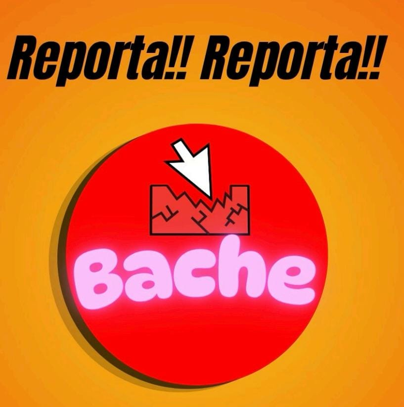
            </div>
        </div>
    </div>
</div>
```

3. Proyecto 2: MiVet
Se integró la tarjeta correspondiente a la plataforma de registro y control de expedientes veterinarios:

```html
<!-- Project Card 2-->
<div class="card overflow-hidden shadow rounded-4 border-0 mb-5">
    <div class="card-body p-0">
        <div class="d-flex align-items-center">
            <div class="p-5">
                <h2 class="fw-bolder">MiVet</h2>
                <p>Plataforma orientada al registro, control de expedientes y administración integral para servicios veterinarios, enfocada en ofrecer una interfaz intuitiva y eficiente.</p>
            </div>
            <div class="p-4 text-center">
                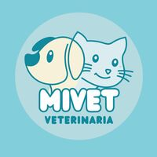
            </div>
        </div>
    </div>
</div>
```

4. Proyecto 3: Artani
Se agregó la tarjeta del sistema de gestión administrativa y control de inventarios diseñado para talleres artesanales:

```html
<!-- Project Card 3-->
<div class="card overflow-hidden shadow rounded-4 border-0">
    <div class="card-body p-0">
        <div class="d-flex align-items-center">
            <div class="p-5">
                <h2 class="fw-bolder">Artani</h2>
                <p>Sistema de gestión administrativa y control de inventarios diseñado específicamente para talleres artesanales (como el Taller de Artesanías El Árbol del Hule), optimizando procesos y flujos de trabajo.</p>
                <a class="btn btn-outline-primary px-3 py-2 text-decoration-none" href="https://github.com/artani-is/artani-sistema" target="_blank">
                    <i class="bi bi-globe me-2"></i>Ver Sitio Web
                </a>
            </div>
            <div class="p-4 text-center">
                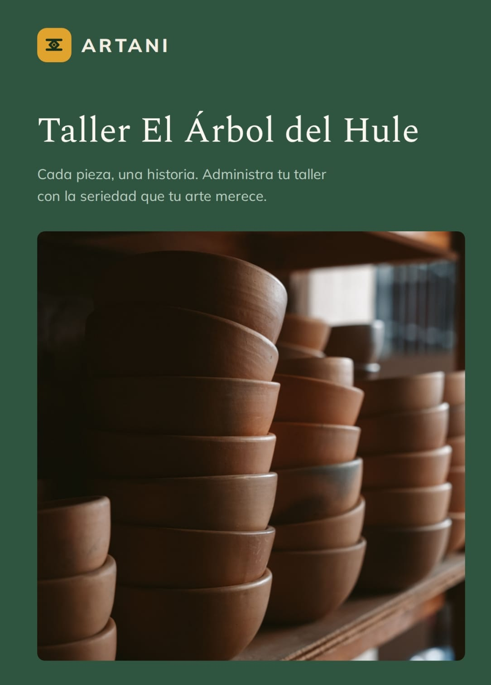
            </div>
        </div>
    </div>
</div>
            </div>
        </div>
    </div>
</section>
```

5. Sección de Llamada a la Acción (Call to Action)
Se añadió la sección final para invitar a los visitantes a establecer contacto:

```html
<!-- Call to action section-->
<section class="py-5 bg-gradient-primary-to-secondary text-white">
    <div class="container px-5 my-5">
        <div class="text-center">
            <h2 class="display-4 fw-bolder mb-4">¿Construimos algo juntos?</h2>
            <a class="btn btn-outline-light btn-lg px-5 py-3 fs-6 fw-bolder" href="contact.html">Contáctame</a>
        </div>
    </div>
</section>
```
**3. Modificaciones Realizadas en el Archivo (contact.html)**

1. Título y Encabezado de la Sección
Se configuró el título de la página y la sección visual de bienvenida para la comunicación:

```html
<!-- Call to action section-->
<title>Contacto - Mi Portafolio</title>
<!-- Favicon-->
<link rel="icon" type="image/x-icon" href="img/favicon.ico" /> 
<div class="text-center mb-5">
    <div class="feature bg-primary bg-gradient-primary-to-secondary text-white rounded-3 mb-3"><i class="bi bi-envelope"></i></div>
    <h1 class="fw-bolder">Ponte en contacto</h1>
    <p class="lead fw-normal text-muted mb-0">¡Trabajemos juntos!</p>
</div>
```

2. Alerta de Mensaje Enviado
Se añadió un contenedor de alerta para notificar al usuario de forma visual al completar satisfactoriamente el envío:

```html
<div id="mensajeAlerta" class="alert alert-success d-none text-center mb-4" role="alert">
    <i class="bi bi-check-circle-fill me-2"></i> ¡Mensaje enviado con éxito! Gracias por contactarte.
</div>
```

3. Formulario Conectado a Formspree
Se implementó el formulario utilizando el servicio de Formspree para el manejo de los correos, estructurado con campos flotantes obligatorios para el nombre, correo, teléfono y mensaje:

```html
<!-- Formulario conectado a Formspree-->
<form id="simpleForm" action="https://formspree.io/f/xwlpzzdk" method="POST">
    <!-- Name input-->
    <div class="form-floating mb-3">
        <input class="form-control" id="name" name="name" type="text" placeholder="Escribe tu nombre..." required />
        <label for="name">Nombre completo</label>
    </div>
    <!-- Email address input-->
    <div class="form-floating mb-3">
        <input class="form-control" id="email" name="email" type="email" placeholder="nombre@ejemplo.com" required />
        <label for="email">Correo electrónico</label>
    </div>
    <!-- Phone number input-->
    <div class="form-floating mb-3">
        <input class="form-control" id="phone" name="phone" type="tel" placeholder="(123) 456-7890" required />
        <label for="phone">Número de teléfono</label>
    </div>
    <!-- Message input-->
    <div class="form-floating mb-3">
        <textarea class="form-control" id="message" name="message" placeholder="Escribe tu mensaje aquí..." style="height: 10rem" required></textarea>
        <label for="message">Mensaje</label>
    </div>
    <!-- Submit Button-->
    <div class="d-grid">
        <button class="btn btn-primary btn-lg" id="submitButton" type="submit">Enviar Mensaje</button>
    </div>
</form>
```

---

## Demostración del SIstema

**Captutras finales**

>Pagina principal

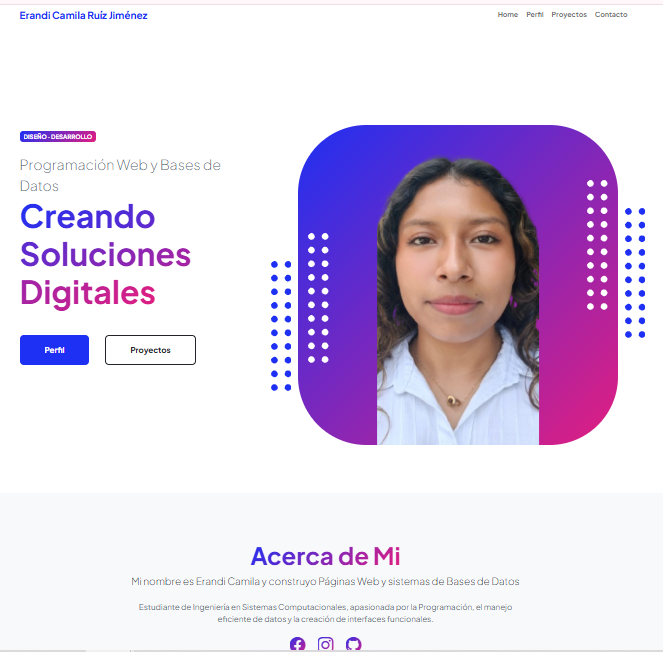

>Perfil.

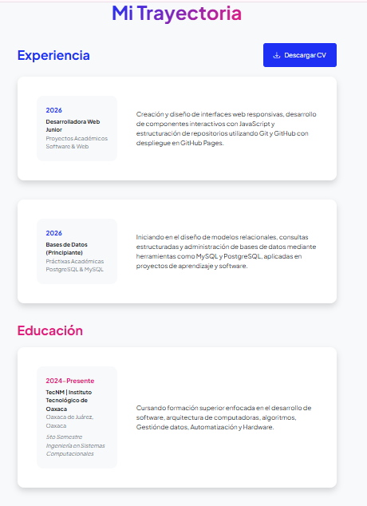
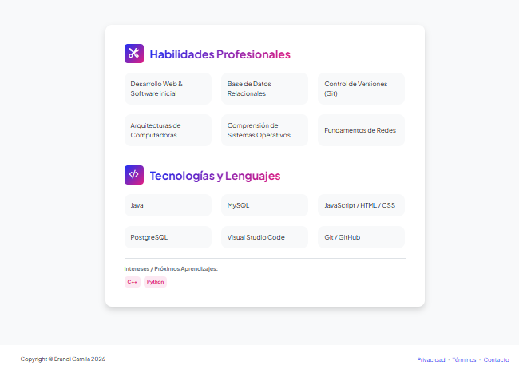


>Proyectos.

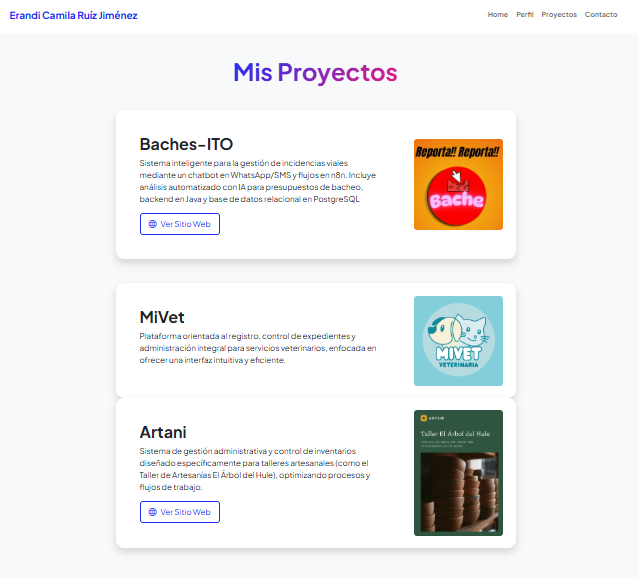
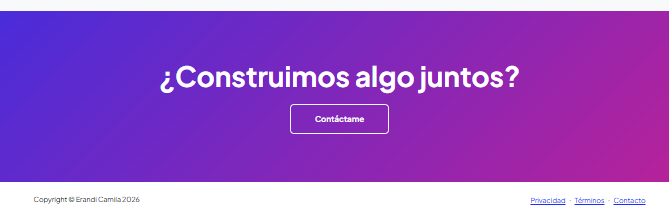

>Contacto.

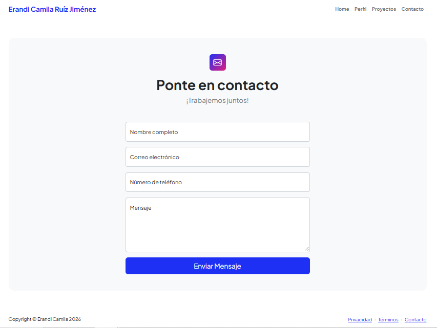
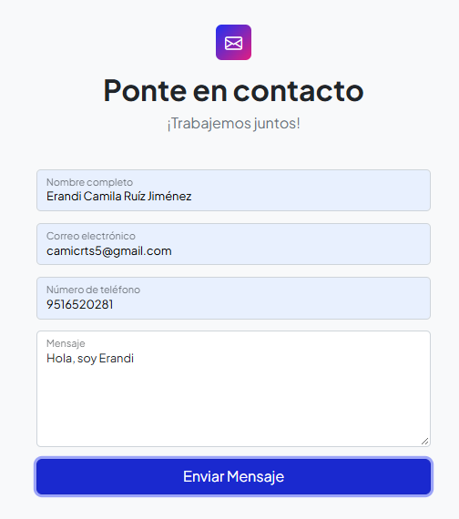
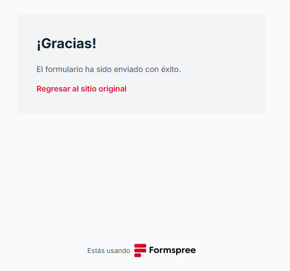
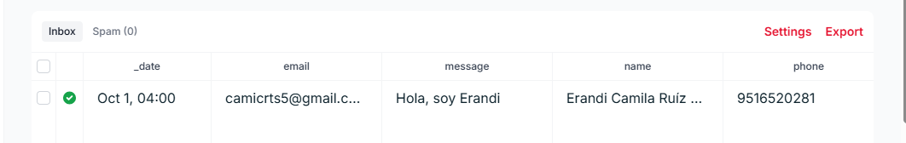

